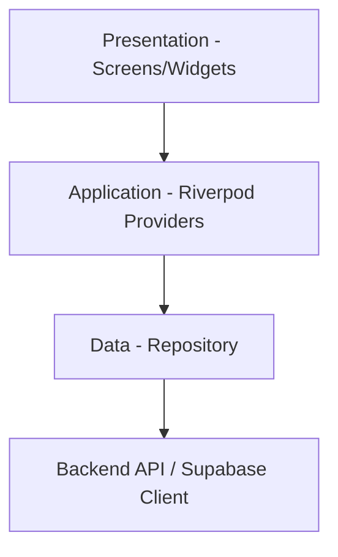
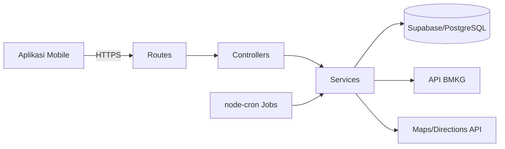
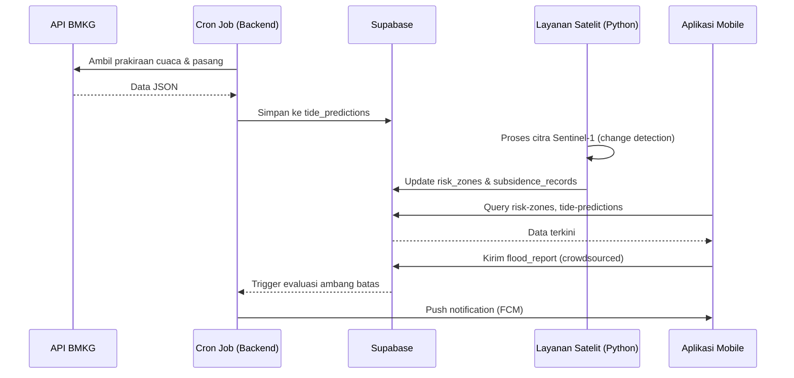

# Cakra Tirta — Dokumen Setup Proyek & Design System

**Proyek:** Cakra Tirta — Sistem Peringatan Dini Rob & Amblesan Tanah Berbasis Data Satelit
**Studi Kasus:** Kota Semarang
**Kompetisi:** DSDC ANFORCOM 2026, Subtema 1 — Smart Waste & Resource Circularity Systems
**Versi Dokumen:** 1.0 — Draf untuk tinjauan tim

> Dokumen ini dirancang untuk dua kebutuhan sekaligus: (1) panduan setup teknis dari nol hingga aplikasi berjalan, dan (2) referensi design system serta arsitektur yang cukup rinci untuk dipakai sebagai konteks saat bekerja dengan AI coding assistant ("vibe coding"). Semua token desain, skema data, dan kontrak API ditulis dalam format yang bisa langsung disalin ke kode.

---

# BAGIAN 1 — TECH STACK & ALUR SETUP PROYEK

## 1.1 Ringkasan Proyek

Cakra Tirta terdiri dari tiga layanan utama yang berjalan terpisah namun saling terhubung:

1. **Aplikasi mobile** (Flutter) — antarmuka utama untuk warga
2. **Backend API** (Node.js/Express + Supabase) — pusat logika bisnis dan data
3. **Layanan data satelit** (Python + Google Earth Engine) — pemrosesan citra Sentinel-1 secara berkala

Lima pilar fitur yang dibangun: **Peta & Rute Cerdas**, **Peringatan Dini Real-Time**, **Dashboard Time-Series Pemkot**, **Simulasi Masa Depan** (diferensiator utama), dan **Edukasi Air Tanah**.

## 1.2 Tech Stack Lengkap

| Layer | Teknologi | Versi Disarankan |
|---|---|---|
| Aplikasi mobile | Flutter (Dart) | Flutter 3.24+ / Dart 3.5+ |
| State management | Riverpod | ^2.5.1 |
| Navigasi | go_router | ^14.2.0 |
| Peta & routing | google_maps_flutter atau mapbox_gl | terbaru stabil |
| Backend API | Node.js + Express | Node 20 LTS, Express ^4.19 |
| Database, Auth, Realtime | Supabase (PostgreSQL) | terbaru (cloud-hosted) |
| Layanan data satelit | Python + earthengine-api + geemap | Python 3.11+ |
| Notifikasi push | Firebase Cloud Messaging | terbaru |
| Hosting backend | Railway atau Render | — |
| Hosting layanan satelit | Google Cloud Run | — |
| Version control | Git + GitHub, GitHub Actions | — |
| Desain antarmuka | Figma | wajib sesuai rulebook DSDC |
| Pengujian API | Postman / Thunder Client | — |

## 1.3 Prasyarat

### 1.3.1 Software & Tools yang Harus Terpasang
- [ ] Flutter SDK (`flutter doctor` harus bersih tanpa error)
- [ ] Node.js 20 LTS + npm
- [ ] Python 3.11+ dan `pip`
- [ ] Git
- [ ] Android Studio / Xcode (untuk emulator)
- [ ] VS Code atau editor lain dengan ekstensi Flutter & ESLint

### 1.3.2 Akun & Layanan Eksternal yang Harus Dibuat
- [ ] Akun [Supabase](https://supabase.com) — buat project baru, catat `Project URL`, `anon key`, `service_role key`
- [ ] Akun [Google Cloud Platform](https://console.cloud.google.com) — untuk Earth Engine dan Cloud Run
- [ ] Akses [Google Earth Engine](https://earthengine.google.com) — daftarkan project GCP yang sama untuk akses Earth Engine API
- [ ] Akun [Firebase](https://console.firebase.google.com) — buat project untuk Cloud Messaging
- [ ] API key [Mapbox](https://mapbox.com) atau [Google Maps Platform](https://console.cloud.google.com/google/maps-apis) (aktifkan Maps SDK + Directions API)
- [ ] Akun [Railway](https://railway.app) atau [Render](https://render.com) untuk hosting backend
- [ ] Akun GitHub untuk repositori & CI

## 1.4 Struktur Folder Monorepo

```
cakra-tirta/
├── mobile/                    # Aplikasi Flutter
├── backend/                   # API Node.js + Express
├── satellite-service/         # Layanan Python + Earth Engine
├── docs/                      # Dokumen proyek (project plan, dokumen ini, dll.)
└── README.md
```

Monorepo dipilih supaya tim kecil (2–3 orang) bisa mengelola ketiga layanan dalam satu repositori tanpa overhead mengurus banyak repo terpisah.

## 1.5 Setup Backend (Node.js + Express + Supabase)

### 1.5.1 Inisialisasi Proyek

```bash
mkdir backend && cd backend
npm init -y
npm install express cors dotenv @supabase/supabase-js axios node-cron firebase-admin morgan
npm install --save-dev nodemon
```

### 1.5.2 Setup Supabase & Environment Variables

Buat file `.env` di root folder `backend/` (jangan pernah commit file ini ke Git):

```env
PORT=4000
SUPABASE_URL=https://xxxxx.supabase.co
SUPABASE_SERVICE_ROLE_KEY=xxxxxxxxxxxxxxxx
SUPABASE_ANON_KEY=xxxxxxxxxxxxxxxx
BMKG_WEATHER_API_BASE=https://api.bmkg.go.id/publik
FIREBASE_SERVICE_ACCOUNT_PATH=./secrets/firebase-service-account.json
MAPS_API_KEY=xxxxxxxxxxxxxxxx
NODE_ENV=development
```

Buat juga `.env.example` (versi tanpa nilai asli) untuk dicommit sebagai referensi tim.

### 1.5.3 Skema Database (SQL)

Jalankan skrip berikut lewat **SQL Editor** di dashboard Supabase untuk membuat seluruh tabel:

```sql
-- Ekstensi untuk UUID
create extension if not exists "pgcrypto";

-- Pengguna (selain tabel auth.users bawaan Supabase Auth)
create table public.users (
  id uuid primary key references auth.users(id) on delete cascade,
  full_name text,
  role text default 'warga' check (role in ('warga','instansi')),
  created_at timestamptz default now()
);

-- Lokasi yang dipantau tiap pengguna (Pilar 2)
create table public.monitored_locations (
  id uuid primary key default gen_random_uuid(),
  user_id uuid references public.users(id) on delete cascade,
  label text not null,
  latitude double precision not null,
  longitude double precision not null,
  created_at timestamptz default now()
);

-- Zona risiko gabungan amblesan + rob per kelurahan (Pilar 1, 3)
create table public.risk_zones (
  id uuid primary key default gen_random_uuid(),
  kelurahan text not null,
  kecamatan text,
  geom jsonb not null,               -- GeoJSON polygon
  risk_level text check (risk_level in ('aman','waspada','bahaya')),
  subsidence_rate_cm_year numeric,
  updated_at timestamptz default now()
);

-- Data amblesan historis per zona, dari studi akademik maupun satelit (Pilar 3, 4)
create table public.subsidence_records (
  id uuid primary key default gen_random_uuid(),
  risk_zone_id uuid references public.risk_zones(id) on delete cascade,
  year int not null,
  rate_cm_year numeric not null,
  source text check (source in ('akademik','satelit')),
  created_at timestamptz default now()
);

-- Prediksi pasang surut (Pilar 2)
create table public.tide_predictions (
  id uuid primary key default gen_random_uuid(),
  location text not null,
  predicted_at timestamptz not null,
  tide_height_cm numeric not null,
  source text default 'BMKG',
  created_at timestamptz default now()
);

-- Laporan genangan dari warga (Pilar 1)
create table public.flood_reports (
  id uuid primary key default gen_random_uuid(),
  user_id uuid references public.users(id),
  latitude double precision not null,
  longitude double precision not null,
  photo_url text,
  water_depth_estimate_cm numeric,
  verified_count int default 1,
  status text default 'pending' check (status in ('pending','verified','expired')),
  created_at timestamptz default now()
);

-- Riwayat notifikasi terkirim (Pilar 2)
create table public.notifications (
  id uuid primary key default gen_random_uuid(),
  user_id uuid references public.users(id),
  title text not null,
  body text not null,
  severity text check (severity in ('info','waspada','bahaya')),
  sent_at timestamptz default now(),
  read_at timestamptz
);

-- Modul edukasi air tanah (Pilar 5)
create table public.education_modules (
  id uuid primary key default gen_random_uuid(),
  title text not null,
  content text not null,              -- markdown/html untuk isi infografis
  cover_image_url text,
  order_index int default 0,
  created_at timestamptz default now()
);

-- Hasil kalkulator dampak pemakaian air tanah pribadi (Pilar 5)
create table public.water_usage_estimates (
  id uuid primary key default gen_random_uuid(),
  user_id uuid references public.users(id) on delete cascade,
  daily_usage_liters numeric not null,
  estimated_subsidence_contribution_mm numeric,
  created_at timestamptz default now()
);

-- Lencana/pencapaian pengguna setelah menyelesaikan modul (Pilar 5)
create table public.user_badges (
  id uuid primary key default gen_random_uuid(),
  user_id uuid references public.users(id) on delete cascade,
  badge_code text not null,           -- mis. 'sadar_air_tanah'
  earned_at timestamptz default now(),
  unique (user_id, badge_code)
);

-- Data curah hujan, dipakai untuk deteksi compound flooding (Pilar 2)
create table public.rainfall_records (
  id uuid primary key default gen_random_uuid(),
  location text not null,
  recorded_at timestamptz not null,
  rainfall_mm numeric not null,
  source text default 'BMKG',
  created_at timestamptz default now()
);

-- Riwayat deteksi luasan genangan dari citra Sentinel-1 (Pilar 1, 3)
-- risk_zones menyimpan status ringkas TERKINI; tabel ini menyimpan setiap hasil deteksi
-- dari waktu ke waktu sehingga dashboard pemkot bisa melihat tren, bukan cuma snapshot terakhir
create table public.flood_extent_detections (
  id uuid primary key default gen_random_uuid(),
  risk_zone_id uuid references public.risk_zones(id) on delete cascade,
  detected_at timestamptz not null,   -- tanggal akuisisi citra Sentinel-1
  geom jsonb not null,                 -- GeoJSON poligon genangan hasil deteksi
  source_image text,                   -- ID/scene citra Sentinel-1 yang dipakai
  created_at timestamptz default now()
);

-- Profil & status verifikasi akun instansi (Pilar 3)
create table public.instansi_profiles (
  id uuid primary key default gen_random_uuid(),
  user_id uuid references public.users(id) on delete cascade unique,
  nama_instansi text not null,
  jenis_instansi text check (jenis_instansi in ('pemerintah','akademik','lainnya')),
  verification_status text default 'pending' check (verification_status in ('pending','verified','rejected')),
  verified_at timestamptz,
  created_at timestamptz default now()
);

-- Index yang sering dipakai
create index idx_flood_reports_location on public.flood_reports (latitude, longitude);
create index idx_risk_zones_kelurahan on public.risk_zones (kelurahan);
create index idx_subsidence_zone_year on public.subsidence_records (risk_zone_id, year);
create index idx_rainfall_location_time on public.rainfall_records (location, recorded_at);
create index idx_flood_extent_zone_date on public.flood_extent_detections (risk_zone_id, detected_at);
```

Aktifkan **Row Level Security (RLS)** untuk tabel yang memuat data pengguna (`users`, `monitored_locations`, `notifications`, `water_usage_estimates`, `user_badges`, `instansi_profiles`) sebelum aplikasi dipakai publik.

### 1.5.4 Struktur Folder Backend

```
backend/
├── src/
│   ├── routes/            # definisi endpoint (risk-zones.js, tide.js, reports.js, ...)
│   ├── controllers/       # logika tiap endpoint
│   ├── services/          # pemanggilan Supabase, BMKG, Maps API
│   ├── middleware/        # auth check, error handler
│   ├── jobs/               # node-cron: sinkronisasi tide, pembersihan laporan basi
│   └── server.js
├── migrations/             # simpan skrip SQL di atas sebagai file .sql bertahap
├── secrets/                 # firebase-service-account.json (JANGAN commit)
├── .env.example
└── package.json
```

### 1.5.5 Menjalankan Server

Tambahkan script berikut ke `package.json`:

```json
"scripts": {
  "dev": "nodemon src/server.js",
  "start": "node src/server.js"
}
```

Jalankan dengan `npm run dev`, verifikasi dengan mengakses `http://localhost:4000/health` yang mengembalikan status `200 OK`.

## 1.6 Setup Aplikasi Mobile (Flutter)

### 1.6.1 Inisialisasi Proyek

```bash
flutter create mobile --org id.ac.polines.cakratirta
cd mobile
```

### 1.6.2 Dependencies

Tambahkan ke `pubspec.yaml`:

```yaml
dependencies:
  flutter:
    sdk: flutter
  flutter_riverpod: ^2.5.1
  go_router: ^14.2.0
  google_maps_flutter: ^2.7.0      # atau mapbox_gl bila memilih Mapbox
  supabase_flutter: ^2.5.6
  firebase_core: ^3.3.0
  firebase_messaging: ^15.0.4
  dio: ^5.5.0
  intl: ^0.19.0
  google_fonts: ^6.2.1
  cached_network_image: ^3.4.0
  geolocator: ^13.0.1
  image_picker: ^1.1.2
```

Jalankan `flutter pub get` setelah menambahkan.

### 1.6.3 Struktur Folder Mobile (Feature-First)

```
mobile/lib/
├── core/
│   ├── theme/              # design tokens: colors.dart, typography.dart, spacing.dart
│   ├── network/             # dio client, interceptor
│   ├── constants/
│   └── router/               # go_router config
├── features/
│   ├── beranda/
│   │   ├── data/             # repository, model
│   │   ├── application/      # riverpod providers/notifiers
│   │   └── presentation/     # screens, widgets khusus fitur ini
│   ├── peta_rute/
│   ├── simulasi_masa_depan/
│   ├── peringatan_dini/
│   ├── edukasi/
│   └── profil/
├── shared/
│   └── widgets/               # StatusCard, MetricCard, PillButton, BottomNavBar
└── main.dart
```

Pola **feature-first** dipilih supaya tiap pilar fitur (lihat Bagian 4 dokumen Project Plan) punya folder sendiri yang mandiri — memudahkan AI coding assistant maupun anggota tim bekerja pada satu fitur tanpa banyak konflik file.

### 1.6.4 Setup Firebase & Peta

1. Jalankan `flutterfire configure` untuk menghubungkan proyek Flutter ke Firebase (menghasilkan `firebase_options.dart`)
2. Tambahkan API key Maps di `android/app/src/main/AndroidManifest.xml` (untuk Android) dan `ios/Runner/AppDelegate.swift` (untuk iOS)
3. Inisialisasi Supabase di `main.dart`:

```dart
await Supabase.initialize(
  url: 'https://xxxxx.supabase.co',
  anonKey: 'xxxxxxxxxxxxxxxx',
);
```

## 1.7 Setup Layanan Data Satelit (Python + Google Earth Engine)

### 1.7.1 Virtual Environment & Dependencies

```bash
cd satellite-service
python3 -m venv venv
source venv/bin/activate   # Windows: venv\Scripts\activate
pip install earthengine-api geemap google-cloud-storage python-dotenv schedule
pip freeze > requirements.txt
```

### 1.7.2 Autentikasi Google Earth Engine

```bash
earthengine authenticate
```

Untuk lingkungan produksi (Cloud Run), gunakan **service account** alih-alih autentikasi interaktif:

```bash
gcloud iam service-accounts create cakra-tirta-ee \
  --display-name "Cakra Tirta Earth Engine"
```

Lalu daftarkan service account tersebut di [signup Earth Engine service account](https://signup.earthengine.google.com/#!/service_accounts) sebelum dipakai di kode.

### 1.7.3 Struktur Folder

```
satellite-service/
├── src/
│   ├── change_detection.py    # deteksi genangan dari Sentinel-1 (lihat Bagian 8.2 Project Plan)
│   ├── gee_auth.py              # autentikasi service account
│   ├── scheduler.py             # job berkala (harian/mingguan)
│   └── export_to_supabase.py    # kirim hasil olahan ke tabel risk_zones
├── requirements.txt
└── .env.example
```

## 1.8 Integrasi Data BMKG — Catatan Penting

- **Curah hujan / prakiraan cuaca**: BMKG menyediakan API publik resmi dan terdokumentasi:
  ```
  GET https://api.bmkg.go.id/publik/prakiraan-cuaca?adm4={kode_wilayah}
  ```
  Dokumentasi dan contoh kode tersedia di repositori GitHub resmi `infoBMKG/data-cuaca`. Kode wilayah (`adm4`) untuk tiap kelurahan di Semarang perlu dicari lewat tabel kode wilayah administrasi Kemendagri. **Wajib mencantumkan BMKG sebagai sumber data** sesuai ketentuan penggunaan.
- **Data pasang surut (tide)**: sejauh penelusuran tim, BMKG **belum memiliki REST API publik yang terdokumentasi resmi** seperti API cuaca di atas. Data tersedia secara visual/unduh di `maritim.bmkg.go.id/cuaca/pasut`. Sebelum pengembangan lebih jauh, tim perlu memilih salah satu jalur berikut:
  1. Menghubungi BMKG lewat jalur PPID/layanan data resmi untuk menanyakan akses API pasang surut;
  2. Memakai fitur unduh data series di situs BMKG Maritim sebagai data batch yang diimpor berkala (bukan real-time API call);
  3. Sebagai cadangan, menghitung estimasi pasang surut dari model astronomis (harmonik) menggunakan data referensi stasiun terdekat, atau memakai data dari Pusat Hidro-Oseanografi TNI AL (Pushidrosal) yang juga mempublikasikan data pasang surut.
- Tim disarankan memverifikasi opsi mana yang paling feasible di awal Sprint 1 (lihat Bagian 9.3 Project Plan), karena ini menentukan desain job berkala di `backend/src/jobs/`.

## 1.9 Deployment & Hosting

| Layanan | Platform | Catatan |
|---|---|---|
| Backend API | Railway / Render | Deploy langsung dari GitHub, set environment variables dari `.env` |
| Layanan satelit Python | Google Cloud Run | Bungkus sebagai container (Dockerfile), jadwalkan lewat Cloud Scheduler |
| Database | Supabase Cloud | Sudah terhosting begitu project dibuat |
| Aplikasi mobile | Distribusi manual (APK) untuk demo kompetisi | Publikasi ke Play Store/App Store opsional, di luar cakupan kompetisi |

## 1.10 Checklist Verifikasi Setup

- [ ] `flutter doctor` bersih tanpa error
- [ ] Backend merespons `GET /health` dengan `200 OK`
- [ ] Tabel Supabase berhasil dibuat dan terlihat di dashboard
- [ ] Aplikasi Flutter berhasil login/register lewat Supabase Auth
- [ ] Notifikasi test berhasil terkirim lewat Firebase Cloud Messaging
- [ ] Skrip Python berhasil autentikasi ke Earth Engine dan menjalankan query citra sederhana
- [ ] Endpoint cuaca BMKG berhasil dipanggil dan mengembalikan data JSON
- [ ] Repositori GitHub sudah punya `.gitignore` yang mengecualikan `.env`, `secrets/`, `venv/`, `node_modules/`, `build/`

---

# BAGIAN 2 — DESIGN SYSTEM & ARSITEKTUR (UNTUK VIBE CODING)

## 2.1 Tentang Cakra Tirta

**Cakra Tirta** (sebelumnya bernama kerja "Tirta Sentinel") adalah platform digital yang menggabungkan data satelit, prediksi pasang surut resmi BMKG, dan laporan warga real-time untuk mengatasi krisis rob dan amblesan tanah di Kota Semarang. Diferensiator utamanya adalah fitur **Simulasi Masa Depan** — proyeksi risiko rob berdasarkan tren amblesan tanah jangka panjang dari data satelit, sesuatu yang belum ditawarkan aplikasi pemantauan bencana manapun di Indonesia saat ini.

**Makna nama:** *Cakra* berarti siklus/roda — merepresentasikan prinsip *Circular Economy* sekaligus citra satelit yang mengorbit terus-menerus mengawasi Bumi. *Tirta* berarti air. Digabungkan, Cakra Tirta melambangkan sistem pengawasan berkelanjutan terhadap siklus air tanah dan ancaman rob di wilayah pesisir — nama yang secara langsung merepresentasikan cara kerja aplikasi ini: memantau secara siklikal, bukan sekali lihat lalu selesai.

Lima pilar fitur yang dibangun: **Peta & Rute Cerdas**, **Peringatan Dini Real-Time**, **Dashboard Time-Series Pemkot**, **Simulasi Masa Depan**, dan **Edukasi Air Tanah** — detail lengkap tiap pilar ada di dokumen Project Plan terpisah.

Arah gaya visual mengikuti referensi yang telah ditentukan tim: dashboard mode gelap dengan gaya **bento grid** dan **soft neo-brutalism**, warna aksen elektrik, dan tipografi bold — dijabarkan lengkap sebagai design token pada bagian berikut.

## 2.2 Design Tokens

### 2.2.1 Warna

| Token | Kode Hex | Penggunaan |
|---|---|---|
| `color.bg` | `#0B0E14` | Kanvas dasar seluruh layar (mode gelap) |
| `color.surface` | `#151A24` | Latar kartu dan komponen utama |
| `color.surfaceAlt` | `#1C222E` | Elemen di dalam kartu (mis. area preview peta) |
| `color.border` | `#2A3140` | Pembatas tipis antar-elemen |
| `color.textPrimary` | `#F5F6FA` | Judul, angka kunci, teks penting |
| `color.textSecondary` | `#8B93A7` | Label, keterangan, teks pendukung |
| `color.aman` (Electric Cyan) | `#2DE0C9` | Status AMAN, elemen identitas/brand |
| `color.waspada` (Volt Amber) | `#FFC93C` | Status WASPADA |
| `color.bahaya` (Hot Coral) | `#FF5C6C` | Status BAHAYA, titik kritis |
| `color.cta` (Volt Green) | `#B6FF3C` | Tombol aksi utama — **bukan** warna status keselamatan, sengaja dipisah agar tidak tertukar makna |

> Aturan wajib: warna status (`aman`/`waspada`/`bahaya`) hanya dipakai untuk merepresentasikan tingkat risiko. Jangan gunakan warna ini untuk elemen dekoratif lain agar makna semantiknya tetap konsisten dan bisa dipahami insting oleh pengguna dalam kondisi darurat.

### 2.2.2 Tipografi

Font utama: **Poppins** (via `google_fonts` package). Alternatif setara: Space Grotesk (angka/judul) + Plus Jakarta Sans (isi), bila tim ingin konsistensi dengan proyek KOLEGA sebelumnya.

| Token | Font & Bobot | Ukuran | Penggunaan |
|---|---|---|---|
| `type.hero` | Poppins Bold | 32–40px | Angka kunci di kartu (jam pasang, nilai amblesan) |
| `type.title` | Poppins Bold | 22–25px | Judul layar, judul kartu status |
| `type.label` | Poppins Medium/SemiBold | 13–15px | Label kartu (kapital), mis. "PASANG TERTINGGI" |
| `type.body` | Poppins Regular | 13–15px | Teks isi, warna `textSecondary` |
| `type.caption` | Poppins Regular | 11–12px | Timestamp, keterangan kecil pada pill/badge |

### 2.2.3 Spacing Scale (basis 4px)

| Token | Nilai |
|---|---|
| `space.xs` | 4px |
| `space.sm` | 8px |
| `space.md` | 12px |
| `space.base` | 16px |
| `space.lg` | 20px |
| `space.xl` | 24px |
| `space.2xl` | 32px |
| `space.3xl` | 40px |
| `space.4xl` | 48px |

### 2.2.4 Radius Scale

| Token | Nilai | Penggunaan |
|---|---|---|
| `radius.sm` | 12px | Elemen kecil (badge kotak) |
| `radius.md` | 16px | Input, tombol persegi |
| `radius.lg` | 22px | Kartu standar |
| `radius.xl` | 28px | Kartu besar, search bar |
| `radius.pill` | 999px | Pill button, chip, toggle |

### 2.2.5 Elevation & Glow

Karena berbasis mode gelap, kedalaman visual dibangun lewat **border tipis + glow warna aksen**, bukan drop-shadow klasik:

| Token | Definisi | Penggunaan |
|---|---|---|
| `elevation.card` | border 1px `color.border` | Kartu standar tanpa status khusus |
| `glow.cyan` | radial glow `#2DE0C9` opacity 35% | Elemen aktif/brand |
| `glow.coral` | radial glow `#FF5C6C` opacity 35% | Elemen status bahaya, tombol darurat |
| `glow.volt` | radial glow `#B6FF3C` opacity 35% | Ikon navigasi aktif, tombol CTA utama |

### 2.2.6 Ikonografi

- Gaya ikon: line icon, stroke width konsisten (±2px pada ukuran 24px)
- Skala ukuran: 16px (micro, di dalam teks), 20px (default), 24px (top bar, nav), 28px (FAB/tombol utama)
- Rekomendasi pustaka ikon Flutter: `lucide_icons` atau `phosphor_flutter` untuk gaya line-icon yang konsisten dengan referensi

## 2.3 Pola Komponen UI

| Komponen | Deskripsi | Prop Kunci |
|---|---|---|
| `StatusCard` | Kartu status utama di Beranda, border berwarna sesuai level risiko | `level (aman/waspada/bahaya)`, `title`, `subtitle` |
| `MetricCard` | Kartu angka kunci (bento kecil) | `label`, `value`, `unit`, `accentColor` |
| `MapPreviewCard` | Kartu berisi cuplikan peta | `riskZones`, `onTap` |
| `PillButton` | Tombol/badge sudut penuh membulat | `label`, `backgroundColor`, `textColor`, `onTap` |
| `AlertBanner` | Banner peringatan dengan border aksen | `severity`, `message`, `actionLabel` |
| `BottomNavBar` | Navigasi bawah 4 menu dengan ikon aktif ber-glow | `currentIndex`, `onTap` |
| `YearSlider` | Slider tahun untuk fitur Simulasi Masa Depan | `minYear`, `maxYear`, `value`, `onChanged` |

Semua komponen kartu memakai `radius.lg` atau `radius.xl`, `elevation.card` sebagai default, dan warna aksen (`glow.*`) hanya muncul saat kartu merepresentasikan status tertentu.

## 2.4 Arsitektur Aplikasi Mobile

- **Pola**: feature-first + layered (data → application → presentation) di tiap folder fitur
- **State management**: Riverpod — setiap fitur punya `Provider`/`NotifierProvider` sendiri di folder `application/`
- **Repository pattern**: folder `data/` tiap fitur berisi kelas repository yang membungkus panggilan ke backend (lewat `dio`) dan/atau langsung ke Supabase client
- **Navigasi**: `go_router` dengan route dideklarasikan terpusat di `core/router/`



## 2.5 Arsitektur Backend

- **Pola**: layered — `routes` menerima request, `controllers` menangani logika HTTP, `services` berisi logika bisnis dan pemanggilan eksternal (Supabase, BMKG, Maps)
- **Job terjadwal** (`node-cron`) menangani sinkronisasi berkala: ambil prediksi cuaca BMKG, bersihkan laporan warga yang sudah kedaluwarsa



## 2.6 Kontrak API

| Method | Endpoint | Deskripsi | Body/Query |
|---|---|---|---|
| GET | `/api/risk-zones` | Ambil zona risiko gabungan | query: `kelurahan` (opsional) |
| GET | `/api/tide-predictions` | Prediksi pasang untuk lokasi tertentu | query: `lat`, `lng`, `date` |
| POST | `/api/flood-reports` | Kirim laporan genangan warga | body: `{ lat, lng, photoUrl, waterDepthEstimateCm }` |
| GET | `/api/flood-reports` | Ambil laporan aktif di area tertentu | query: `bbox`, `since` |
| GET | `/api/subsidence/projection` | Hasil proyeksi Simulasi Masa Depan | query: `lat`, `lng`, `year` |
| GET | `/api/subsidence/history` | Data historis untuk dashboard pemkot | query: `kelurahan` |
| POST | `/api/notifications/subscribe` | Daftar lokasi pantauan untuk push notif | body: `{ userId, label, lat, lng }` |
| GET | `/api/route` | Rekomendasi rute yang hindari zona bahaya | query: `originLat`, `originLng`, `destLat`, `destLng` |
| GET | `/api/education/modules` | Daftar modul edukasi air tanah | — |
| GET | `/api/education/modules/:id` | Detail satu modul edukasi | — |
| POST | `/api/education/water-usage` | Hitung estimasi kontribusi amblesan dari kalkulator dampak | body: `{ userId, dailyUsageLiters }` |
| GET | `/api/education/badges` | Lencana yang sudah didapat pengguna | query: `userId` |
| GET | `/api/rainfall` | Data curah hujan untuk lokasi & rentang waktu tertentu | query: `location`, `since` |
| GET | `/api/flood-extent` | Riwayat deteksi genangan satelit per zona (untuk dashboard time-series) | query: `riskZoneId`, `since` |
| POST | `/api/instansi/verify` | Ajukan verifikasi akun instansi | body: `{ userId, namaInstansi, jenisInstansi }` |
| GET | `/api/instansi/profile` | Ambil status verifikasi akun instansi | query: `userId` |

Contoh respons `GET /api/subsidence/projection`:

```json
{
  "location": { "lat": -6.9147, "lng": 110.4172 },
  "year": 2032,
  "riskLevel": "bahaya",
  "estimatedFloodDaysPerYear": 32,
  "projectedElevationCm": -14.2
}
```

## 2.7 Skema Data (Ringkasan Relasi)

```
users (1) ──< monitored_locations
users (1) ──< flood_reports
users (1) ──< notifications
users (1) ──< water_usage_estimates
users (1) ──< user_badges
users (1) ──1 instansi_profiles
risk_zones (1) ──< subsidence_records
risk_zones (1) ──< flood_extent_detections
risk_zones (1) ──< tide_predictions (via lokasi)
rainfall_records (independen, dikaitkan lewat lokasi + waktu saat evaluasi compound flooding)
education_modules (independen, dibaca langsung tanpa relasi user)
```

Lihat Bagian 1.5.3 untuk DDL SQL lengkap tiap tabel.

## 2.8 Alur Data End-to-End



## 2.9 Konvensi Kode & Commit

- **Penamaan file Flutter**: `snake_case.dart`; nama class: `PascalCase`
- **Penamaan file backend**: `kebab-case.js`; nama fungsi: `camelCase`
- **Commit message**: format Conventional Commits — `feat: tambah kartu status beranda`, `fix: perbaiki query risk-zones`, `chore: update dependency`
- **Branch**: `main` (stabil), `develop` (integrasi), `feature/nama-fitur` per pilar

## 2.10 Ringkasan Konteks Siap-Pakai untuk AI Coding Assistant

Blok berikut bisa langsung ditempel sebagai konteks awal saat memulai sesi coding dengan AI assistant:

```
Proyek: Cakra Tirta — aplikasi peringatan dini rob & amblesan tanah untuk Kota Semarang.
Stack: Flutter (Riverpod, go_router) + Node.js/Express + Supabase (PostgreSQL) + Python/Google Earth Engine untuk pemrosesan citra Sentinel-1.
Struktur: monorepo dengan folder mobile/, backend/, satellite-service/.
Desain: mode gelap, gaya bento grid + soft neo-brutalism. Warna dasar #0B0E14 (bg), #151A24 (surface).
Warna status: aman=#2DE0C9, waspada=#FFC93C, bahaya=#FF5C6C. Warna CTA=#B6FF3C (terpisah dari warna status).
Font: Poppins (Bold untuk angka/judul, Regular untuk isi).
5 fitur utama: Peta & Rute Cerdas, Peringatan Dini Real-Time, Dashboard Time-Series Pemkot, Simulasi Masa Depan (diferensiator utama, proyeksi risiko berbasis tren amblesan satelit), Edukasi Air Tanah.
Pola arsitektur mobile: feature-first, tiap fitur punya folder data/application/presentation sendiri.
```

---

*Dokumen ini adalah draf awal untuk ditinjau tim sebelum dipakai sebagai acuan pengembangan.*
